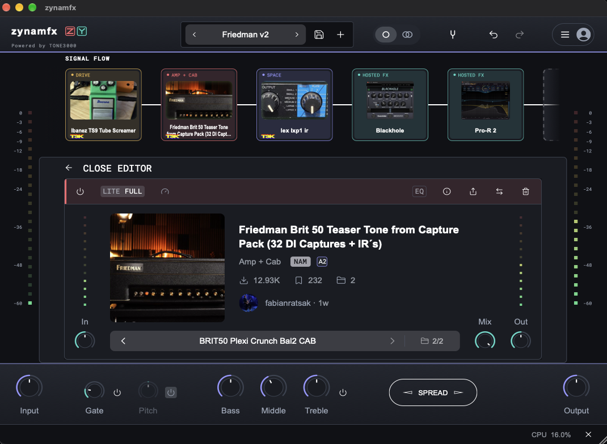

# zynamfx v2



**zynamfx** is a free, open-source macOS guitar signal-chain application. It is available as a Standalone app and as Audio Unit (AU) and VST3 plug-ins. It loads Neural Amp Modeler (NAM) captures and impulse responses (IRs), and can host separately installed AU/VST3 effects.

This is the public **Version 2** line. The earlier public project remains available as [tone3000-plugin-effects (Version 1)](https://github.com/zackyusof/tone3000-plugin-effects). Version 2 gives the project its own zynamfx product identity, standalone application, interface, settings location, and release line. It builds on the open-source TONE3000 codebase; it is not an official TONE3000 product and has no TONE3000 or Line 6 endorsement.

## What it does

- **Build guitar rigs:** arrange NAM amp/capture blocks and IR cabinet blocks in a signal chain. Each independent chain starts with seven slots; add, remove, reorder, duplicate, bypass, and save blocks in presets.
- **Load models:** browse and select tones through TONE3000's hosted OAuth experience, or load your own local `.nam` captures and IR `.wav` files. Models are downloaded only after you choose them; creator attribution and model-license information are retained.
- **Shape the sound:** use per-block level, mix, and six-band EQ, plus global input/output, gate, pitch shift, bass/middle/treble, and stereo spread controls. Presets and session state keep the rig ready for the next session.
- **Host installed effects:** add separately installed AU or VST3 effects to the chain. zynamfx lists installed plug-ins without bundling them; opening an effect displays that plug-in's own editor window.
- **Resize the interface:** the editor window and its contents resize freely together.
- **Use it standalone or in a DAW:** the Standalone app manages its own audio device; AU and VST3 run inside compatible macOS hosts.

## macOS configuration and data locations

Per-user zynamfx files are stored under `~/Library/Application Support/zynamfx/`:

- `zynamfx.settings` — Standalone audio-device setup and related JUCE host settings.
- `preferences.settings` — machine-wide plug-in defaults, including multi-core processing, the default NAM model size, input calibration, and oversampling. Shared by Standalone, AU, and VST3.
- `ui-preferences.settings` — interface preferences, your optional TONE3000 publishable key, and the remembered TONE3000 sign-in session. Treat this file as private; it contains saved access and refresh tokens. Signing out clears the saved session.
- `Presets/` — presets saved by the user. Factory presets installed for all users are in `/Library/Application Support/zynamfx/Presets/Factory/`.
- `LocalModels/` — copies of local NAM and IR files imported into zynamfx, so rigs can still find them if the original files are moved.

The diagnostic log is `~/Library/Logs/zynamfx/zynamfx.log`. AU and VST3 chain state is saved by the DAW in its project or session; user presets are separate files in `Presets/` and include the active model data needed to reopen them offline.

## Version 2 compared with Version 1

Version 1 is the public [tone3000-plugin-effects](https://github.com/zackyusof/tone3000-plugin-effects) repository. Version 2 is the separate **zynamfx** product and public repository. It uses its own app name, icon, plug-in identifiers, configuration/settings folder (`zynamfx`), standalone bundle, graphics, and release artifacts. The TONE3000 NAM/IR processing foundation and required third-party notices remain credited and licensed under their applicable terms. The two repositories are related source lines, not interchangeable product names; Version 2 does not replace Version 1.

**Starting chain slots:** Version 1 shows five slots per lane in an empty chain; Version 2 shows seven, adding two starting slots per lane. This is the initial layout, not a maximum: both versions add a trailing slot as blocks are added.

## How it differs from the official TONE3000 plug-in

TONE3000 owns and operates its account, catalog, and hosted tone-selection service. zynamfx supplies its own signal-chain app and interface while preserving TONE3000 attribution wherever its integration is used. Full catalog browsing and tone selection use TONE3000's hosted OAuth Select experience; zynamfx does not mirror the catalog, bundle catalog models, or present TONE3000 services as its own. Its in-app catalog preview is limited to bounded feeds, and the user requests each model they load.

Public builds contain no API key, account token, or downloaded catalog model. Configure your own TONE3000 **publishable key (client ID)** in Settings → Plugin → TONE3000 API key, then sign in with your account. Never enter a secret key. The product and its builds are free, open source, and have no paid product or upsell. The integration is designed for the current non-commercial Free tier and its documented OAuth flows and bounded list endpoints; API access and terms remain controlled by TONE3000. See the [API Terms](https://www.tone3000.com/api/terms), [API guidance](https://www.tone3000.com/api), and [integration review](docs/tone3000-integration-2026-10-12.md).

The interface identifies the integration as **Powered by TONE3000** and links to [tone3000.com](https://www.tone3000.com). zynamfx uses its own wordmark and graphics. It does not use TONE3000's logo or claim affiliation, approval, or endorsement. Any creator content remains subject to its creator-selected license and attribution requirements.

## Download

The [latest release](https://github.com/zackyusof/zynamfx/releases/latest) contains the macOS Apple Silicon Standalone app, AU/VST3 plug-ins, and the corresponding source archive. Builds are ad-hoc signed and are not notarized. See the release notes for installation instructions and supported formats.

### Gatekeeper on first launch

The release builds are ad-hoc signed but not notarized, so macOS may warn that it cannot verify the developer. Only use this exception for a copy downloaded from the [official zynamfx releases](https://github.com/zackyusof/zynamfx/releases), and stop if macOS reports that the app contains malware or is damaged.

To open the Standalone app, try opening `zynamfx.app` once. If macOS blocks it with a developer-verification warning, open **System Settings → Privacy & Security**, scroll to **Security**, choose **Open Anyway** beside zynamfx, and confirm. Apple says this option appears for about an hour after the blocked launch; approving the app this way leaves Gatekeeper enabled.

If an audio host specifically refuses to load an installed AU or VST3 bundle because of its quarantine flag, first verify that the bundle came from the official release. Then remove quarantine from only the affected zynamfx bundle and restart the host:

```sh
# Run only the command for the format you installed.
xattr -dr com.apple.quarantine "$HOME/Library/Audio/Plug-Ins/Components/zynamfx.component"
# Or, for VST3:
xattr -dr com.apple.quarantine "$HOME/Library/Audio/Plug-Ins/VST3/zynamfx.vst3"
```

These commands target the specific user-installed bundle; do not use a wildcard or disable Gatekeeper globally. See Apple's instructions for [opening an app by overriding security settings](https://support.apple.com/en-gb/guide/mac-help/mh40617/27/mac/27) and its overview of [Gatekeeper and runtime protection](https://support.apple.com/en-ie/guide/security/sec5599b66df/web).

## Build from source

Requires macOS, Xcode Command Line Tools, CMake, Ninja, and Git.

```sh
git clone --recurse-submodules https://github.com/zackyusof/zynamfx.git
cd zynamfx
python3 script/build-stadium-prototype.py
```

The build produces `zynamfx.app`, `zynamfx.component` (AU), and `zynamfx.vst3`. Add `--install` to install them to the Desktop and the standard user plug-in folders. The build is keyless by default; enter your own publishable key in the app if you want to use the TONE3000 integration.

Future hardware send/return support is documented in the [external effects research note](docs/hardware-insert-research-2026-10-12.md). It is a proposed feature, not part of the current release.

GitHub Actions checks the latest stable release of [tone-3000/tone3000-plugin](https://github.com/tone-3000/tone3000-plugin) daily. When it finds a newer release, it merges that upstream tag, updates the recorded upstream commit, increments the zynamfx patch version, builds all three macOS formats, validates the AU, packages corresponding source, and publishes a zynamfx release. Each release title and notes identify the exact TONE3000 release and commit used as its base, and the downloads include an `UPSTREAM.txt` provenance file. If upstream changes conflict with zynamfx-specific files, the workflow stops without publishing so the changes can be reviewed and resolved.

## Licensing and attribution

The combined zynamfx application is distributed under **GNU AGPLv3**. Original TONE3000 source portions remain under their upstream **MIT** license; NAM, AudioDSPTools, JUCE, fonts, icons, and other components keep their own notices. The release includes a source archive matching the shipped build. See [LICENSE-SCOPE.md](LICENSE-SCOPE.md), [SOURCE.md](SOURCE.md), [COPYING](COPYING), and the component license notices.

TONE3000 is credited as the source of the upstream application and the provider of the catalog service. NeuralAmpModelerCore and AudioDSPTools are credited to their upstream authors. zynamfx is an independent community project; all referenced names and marks belong to their respective owners.
